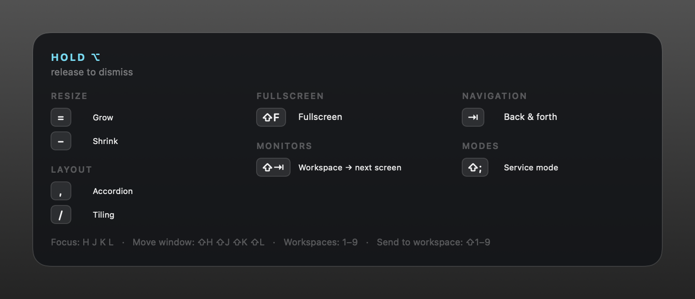
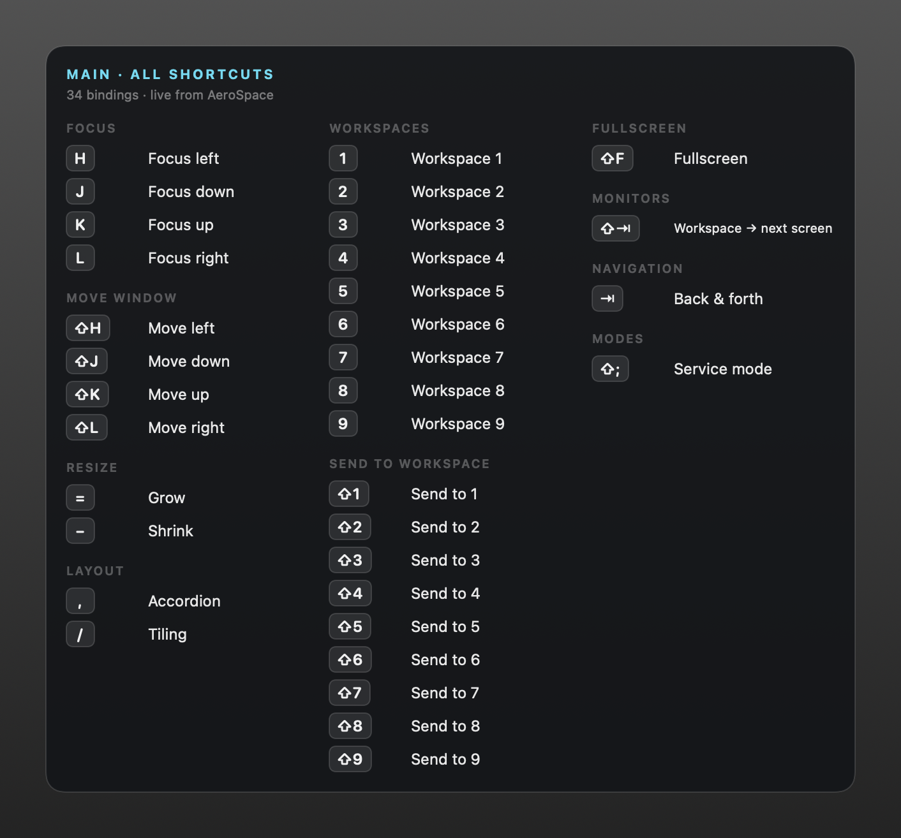

# HotkeyShow

A menu bar app that shows your [AeroSpace](https://nikitabobko.github.io/AeroSpace/) keybindings, contextually — built for the shortcuts you keep forgetting.

The headline feature is the **mode panel**. AeroSpace gives no visual sign that you are inside a binding mode, so HotkeyShow draws the mode's own keymap the moment you enter it:


Hold **⌥** for a moment and a peek card fades in with the bindings you rarely reach for — layouts, resize, monitors, back & forth, other modes. No permissions, no event taps:



Click the menu bar item for the full, searchable sheet:



## What it does

- **Peek on hold ⌥** — after 0.3 s of hesitation a card appears with the non-obvious bindings. Focus/move `hjkl`, `1–9` workspaces and `⇧1–9` sends are collapsed into one dim line, because you already know those. Press any binding or release ⌥ and it disappears.
- **Mode panel** — entering `service` (or any other mode) immediately shows that mode's bindings, with the exit key highlighted. It stays up until you leave the mode, so it doubles as "you are in a mode" feedback.
- **Menu bar sheet** — the current workspace number, plus a searchable list of every binding. A binding AeroSpace itself cannot parse is not shown, so the card reflects what will actually work.

Everything is read live from the running AeroSpace: `list-modes --json` discovers modes, and `config --get mode.<id>.binding --json` dumps a mode's bindings in one call. There is no second copy of your shortcuts to drift, and no hardcoded `service` — add a `resize` mode and it appears on the next refresh.

## Requirements

- macOS 13 or newer
- AeroSpace running
- Xcode command line tools (Swift 5.9+)

## Build and run

```sh
./scripts/build-app.sh
open build/HotkeyShow.app
```

The app is `LSUIElement` — menu bar only, no Dock icon. Launch at login is a toggle in the menu's `⋯` menu.

## Staying in sync

The app shows the config AeroSpace has **loaded**, not what it guesses is on disk. Add this to `~/.aerospace.toml` so edits take effect a moment after each save:

```toml
auto-reload-config = true
```

Without that line the app still notices the file change and warns `config saved · not reloaded yet`; the menu then has **Reload AeroSpace config**. The app polls `~/.aerospace.toml` once a second and re-reads bindings ~0.6 s after a save.

Note: `aerospace config --get` only exposes a curated subset of keys (it will not answer `gaps` either), so this one setting is read straight from the file. Everything else comes from the server.

## Permissions

**None.** The Option key is read with `CGEventSource.flagsState(.combinedSessionState)` plus `NSEvent.modifierFlags` — a read-only query of the session's modifier state. There is no event tap, no key logging, and no Input Monitoring or Accessibility prompt. Menu → **Check ⌥ detection** verifies it on your machine.

Mode, workspace and binding events come from `aerospace subscribe --all`, so the app knows when a binding fires without watching any keyboard input.

## Diagnostics

```sh
.build/debug/HotkeyShow --dump                       # text dump of every mode's bindings
.build/debug/HotkeyShow --snapshot build/snapshots   # render the cards to PNG
tail -f ~/Library/Logs/HotkeyShow.log
```

`--dump` is the quick way to check that the app is reading what you think it is:

```
mode service   base: (none)   bindings: 8
  JOIN WINDOW
    ⌥⇧H                 Join with ←   [exit]
  ...
  AEROSPACE
    ⎋                   Reload config   [exit]
```

## Layout

| Path | What |
| --- | --- |
| `Sources/HotkeyShow/Model` | Chord parsing, command → plain English, sheet/column layout |
| `Sources/HotkeyShow/Services` | `aerospace` CLI client, event stream, config watcher, modifier watcher |
| `Sources/HotkeyShow/UI` | Sheet view, overlay panel, menu bar content |
| `Tests/HotkeyShowTests` | Parsing, labelling, compression and config tests (`swift test`) |
| `scripts/build-app.sh` | Builds and ad-hoc signs `HotkeyShow.app` |
| `docs/` | Screenshots rendered by `--snapshot` |

## How it works

- A borderless, non-activating `NSPanel` at `.floating` level shows over normal windows and other apps' full-screen spaces. It never becomes key or main, and `ignoresMouseEvents` lets clicks fall through.
- The peek appears only after Option has been held *still* for 0.3 s, so normal fast `⌥`+key use never flashes it. When a binding fires, the app asks AeroSpace what it was and flashes that keycap.
- Rounding, blur and layout come from one SwiftUI view shared by the overlay, the menu and the snapshot renderer — so what you see in the README is exactly what the app draws.

## Known limits

- Pausing with ⌥ held while typing an Option-combined character (⌥E, ⌥U, …) can flash the peek. The threshold is 0.3 s, and any AeroSpace binding dismisses it immediately.
- The card appears on the screen under the mouse pointer. That matches focus because AeroSpace's default `on-focused-monitor-changed = ['move-mouse monitor-lazy-center']` moves the pointer to the focused monitor; without that callback it follows the pointer instead.
- The menu sheet caps at 620 pt of scrollable height; a very large config scrolls.
