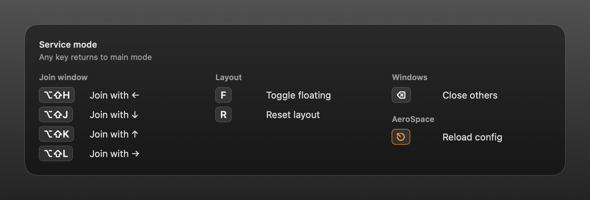

# HotkeyShow

A menu bar app that shows your [AeroSpace](https://nikitabobko.github.io/AeroSpace/) keybindings, contextually — built for the shortcuts you keep forgetting.

AeroSpace gives no visual sign that you are inside a binding mode, so HotkeyShow draws the mode's own keymap the moment you enter it:



Hold **⌥** for a moment and a peek card fades in with the bindings you rarely reach for — resize, layout, monitors, navigation, other modes:


Click the menu bar item for the full, searchable sheet. Mode rows are clickable, so you can read service mode's shortcuts without entering it:


## Features

- **Mode panel** — entering `service` (or any mode) immediately shows that mode's bindings. The exit key is highlighted, and a plain-language line says how to get back: *Any key returns to main mode* when every binding in the mode ends in `mode main`, or the specific exit key otherwise. It stays up until you leave the mode, so it doubles as "you are in a mode" feedback.
- **Peek on hold ⌥** — after 0.3 s of hesitation a card appears with the non-obvious bindings. Focus/move `hjkl`, `1–9` workspaces and `⇧1–9` sends are collapsed into one dim line, because you already know those. Press any binding or release ⌥ and it disappears. The peek has no title — holding ⌥ is the context.
- **Menu bar sheet** — a searchable list of the bindings for **the mode you are in**: open it during service mode and it lists join/float/reset/close rather than the main grid. Mode rows have a chevron — click *Service mode* to read its shortcuts without entering it, and the back button returns to the live mode.
- **Live, not copied** — modes and bindings come from the running AeroSpace, so there is no second cheat sheet to drift. Add a `resize` mode and it appears on the next refresh.

## Install

Download `HotkeyShow-0.1.0.zip` from [Releases](https://github.com/gabathanasiou/hotkeyshow/releases), unzip it, and move `HotkeyShow.app` to `/Applications`.

The build is ad-hoc signed, not notarized, so the first launch needs **right-click → Open**, or:

```sh
xattr -dr com.apple.quarantine /Applications/HotkeyShow.app
```

Or build from source:

```sh
git clone https://github.com/gabathanasiou/hotkeyshow.git
cd hotkeyshow
./scripts/build-app.sh
open build/HotkeyShow.app
```

**Requirements:** macOS 13 or newer, AeroSpace running, Xcode command line tools (Swift 5.9+) for building.

The app is `LSUIElement` — menu bar only, no Dock icon. Launch at login is a toggle in the `⋯` menu.

## Usage

- Enter service mode (`⌥⇧;` in the default config) → the mode panel appears at the bottom of the focused screen and stays until you leave the mode.
- Hold `⌥` → the peek; release it, or press any AeroSpace binding, to dismiss.
- Click the status item → full sheet for the current mode, with search and mode browsing.
- `⋯` → launch at login, refresh, reload AeroSpace config, check ⌥ detection, reveal log, quit.

## Staying in sync

The app shows the config AeroSpace has **loaded**, not what it guesses is on disk. Add this to `~/.aerospace.toml` so edits take effect a moment after each save:

```toml
auto-reload-config = true
```

Without that line the app still notices the file change and warns `config saved · not reloaded yet`; the menu then has **Reload AeroSpace config**. The app polls `~/.aerospace.toml` once a second and re-reads bindings ~0.6 s after a save.

Note: `aerospace config --get` only exposes a curated subset of keys (it will not answer `gaps` either), so this one setting is read straight from the file. Everything else comes from the server.

## Permissions

**None.** The Option key is read with `CGEventSource.flagsState(.combinedSessionState)` plus `NSEvent.modifierFlags` — a read-only query of the session's modifier state. There is no event tap, no key logging, and no Input Monitoring or Accessibility prompt. `⋯` → **Check ⌥ detection** verifies it on your machine.

Mode and binding events come from `aerospace subscribe --all`, so the app knows when a binding fires without watching any keyboard input.

## Why a companion app?

AeroSpace has no plugin API, so adding this to it would mean maintaining a fork against monthly releases. HotkeyShow stays outside: `list-modes --json` discovers modes, `config --get mode.<id>.binding --json` dumps a mode's bindings in one call, and `subscribe --all` reports mode changes and binding triggers. Upgrading AeroSpace does not break it, and nothing about your window manager is modified.

## Diagnostics

```sh
.build/debug/HotkeyShow --dump                       # text dump of every mode's bindings
.build/debug/HotkeyShow --snapshot build/snapshots   # render the cards to PNG
tail -f ~/Library/Logs/HotkeyShow.log
```

`--dump` is the quick way to check that the app is reading what you think it is:

```
mode service   base: (none)   bindings: 8
  JOIN WINDOW
    ⌥⇧H                 Join with ←   [exit]
  ...
  AEROSPACE
    ⎋                   Reload config   [exit]
```

## Development

```sh
swift build
swift test            # 22 tests: chord parsing, labelling, compression, config
./scripts/build-app.sh
```

| Path | What |
| --- | --- |
| `Sources/HotkeyShow/Model` | Chord parsing, command → plain English, sheet/column layout |
| `Sources/HotkeyShow/Services` | `aerospace` CLI client, event stream, config watcher, modifier watcher |
| `Sources/HotkeyShow/UI` | Sheet view, overlay panel, menu bar content, native AppKit views |
| `Tests/HotkeyShowTests` | Parsing, labelling, compression and config tests |
| `scripts/build-app.sh` | Builds and ad-hoc signs `HotkeyShow.app` |
| `docs/` | Screenshots rendered by `--snapshot` |

## How it works

- SwiftUI for layout, AppKit for the pieces SwiftUI cannot do (`NSPanel`, `NSVisualEffectView`, `NSSearchField`, `MenuBarExtra`). No web views, no runtime to bundle, no third-party dependencies — the binary is under a megabyte.
- A borderless, non-activating `NSPanel` at `.floating` level shows over normal windows and other apps' full-screen spaces. It never becomes key or main, and `ignoresMouseEvents` lets clicks fall through.
- The menu is a system popover: `.menu` vibrancy, semantic colors, SF Pro at 13/11 pt, the real `NSSearchField`, menu-style rows with right-aligned shortcuts, hover highlight, and the system accent.
- The peek appears only after Option has been held *still* for 0.3 s, so normal fast `⌥`+key use never flashes it. When a binding fires, the app asks AeroSpace what it was and flashes that keycap.
- One SwiftUI view is shared by the overlay, the menu and the snapshot renderer, so what you see in the screenshots above is what the app draws.

## Known limits

- Pausing with ⌥ held while typing an Option-combined character (⌥E, ⌥U, …) can flash the peek. The threshold is 0.3 s, and any AeroSpace binding dismisses it immediately.
- The card appears on the screen under the mouse pointer. That matches focus because AeroSpace's default `on-focused-monitor-changed = ['move-mouse monitor-lazy-center']` moves the pointer to the focused monitor; without that callback it follows the pointer instead.
- The menu sheet scrolls once it exceeds 640 pt; a very large config scrolls instead of filling the screen.
- The status item shows a single icon rather than the workspace number — keep your existing workspace indicator.
